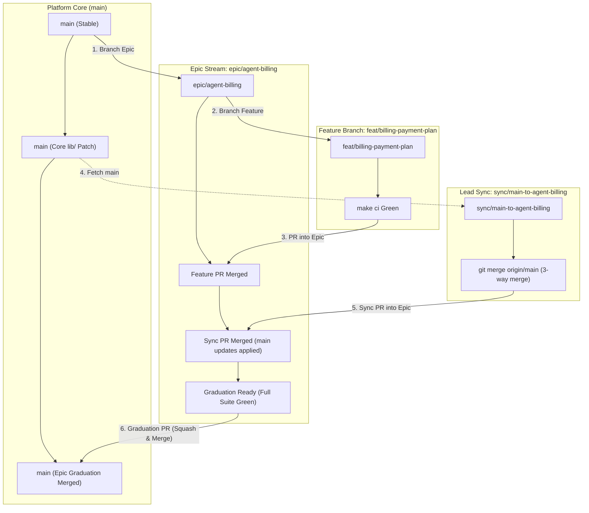

# Git Branching Strategy & Developer Workflow

This guide explains how Git branches, worktrees, and **Pull Requests** (**PRs**) work when building a **Google Customer Experience Agent Studio** (**CXAS**, also called **Customer Engagement Suite** (**CES**) or **Gemini Enterprise for Customer Experience** (**GECX**)) conversational agent.

It supports **two operating modes** using the same branch naming conventions and PR template:
1. **Mode A — Fast Bootcamp / Single-Builder Loop (Default for Timed Builds):** Short-lived `fix/<n>-<slug>` branches isolated in local Git worktrees (`../<agent>-wt/fix/<slug>`) targeting `main`.
2. **Mode B — Multi-Team Epic Stream Workflow (from `cloud-ai-fde/bryankelly-gecx-agent-blueprint`):** Long-lived `epic/<scope>-<desc>` branches for domain sub-teams (`feat/*` $\rightarrow$ `epic/*` $\rightarrow$ `main`) with twice-weekly `sync/main-to-<epic>` merges.

---

## 1. Branch Taxonomy & Naming Conventions

Every branch name follows the pattern:
```text
<category>/<scope>-<short-description>
```

| Category | Pattern | Purpose | PR Target | Merge Strategy |
| :--- | :--- | :--- | :--- | :--- |
| **Core** | `main` | Stable source of truth. Always passes `make ci` and the cloud evaluation gate. | N/A | N/A |
| **Fix** | `fix/<n>-<slug>` or `fix/<scope>-<desc>` | Single root-cause defect fix ($\le 80$ gross lines across $\le 6$ files). | `main` (Mode A) or active `epic/*` (Mode B) | **Squash & Merge** (into `main`) |
| **Feature** | `feat/<scope>-<desc>` | Discrete tool, callback, or dialog capability. | `epic/<scope>-<desc>` or `main` | **Merge Commit** (into `epic/*`) / **Squash & Merge** (into `main`) |
| **Epic** | `epic/<scope>-<desc>` | Long-lived stream for a specialist sub-agent (e.g., `epic/agent-billing`). | `main` (Graduation PR) | **Squash & Merge** |
| **Sync** | `sync/main-to-<epic>` | Stream lead branch to merge latest `main` changes into an active `epic/*` branch. | Destination `epic/*` | **Merge Commit** |
| **Release** | `release/<scope>-v<version>` | Versioned deployment track for production releases. | Deployed to Prod | **Merge Commit** |
| **Hotfix** | `hotfix/<scope>-<desc>` | Urgent production patch. | `release/*` or `main` | **Squash & Merge** |

### Scope Names
- **Specialist Sub-Agents:** `agent-<name>` (e.g., `agent-billing`, `agent-tech`, `agent-sales`, `agent-account`)
- **Shared Core (`lib/` & routing):** `core`, `router`, `lib`, `speech`
- **Tooling & Evaluations:** `tools`, `callbacks`, `evals`, `ci`

---

## 2. Mode A: Fast Bootcamp / Parallel Git Worktree Workflow

When one engineer (with multiple AI coding subagents) is hill-climbing an agent under time pressure:

1. **Create an isolated Git worktree per fix branch** so parallel coding agents never step on each other's files:
   ```bash
   git worktree add ../my-agent-wt/fix/1-otp-state -b fix/1-otp-state main
   cd ../my-agent-wt/fix/1-otp-state
   ```
2. **Develop and pass Offline Gate 0 (`make ci`) inside the worktree:**
   ```bash
   make bundle        # Inline shared lib/*.py into standalone cxas_app/ files
   make format        # Format Python code
   make ci            # bundle-check + overfit-check + eval-contract + cxas lint (fails on warnings not in lint_waivers.json) + pytest (>=80% per file) + verify_mutations
   make impact        # List evaluation IDs impacted by your change, plus a Verdict: line
   git add -A && git commit -m "<area>: <what changed>"   # cloud steps refuse uncommitted cxas_app/, lib/ or evals/
   ```
3. **Measure on the Cloud Confidence Ladder (serially, one branch at a time).** The `Makefile` enforces this order: push, then smoke, then the full run. `make bench-full` rebuilds `history/eval_impact_map.json` after every full run, so the smoke requirement applies from the second full run on; the first full run on a fresh repo or CI runner is the bootstrap exception.
   ```bash
   make push ENV=staging                              # runs make preflight first (ADC identity, quota project, permissions); records the pushed commit
   make smoke-impact ENV=staging                      # Gate 1: impacted evaluations x 3 on the pushed code (must pass 3/3 with 0 tool errors)
   make bench-unstable ENV=staging                    # Gate 2: 5 repeats on unstable set
   make bench-full ENV=staging                        # Gate 3: full suite x 3 (from the second full run on, refused until smoke-impact passes for this code)
   make gate3                                         # Gate 3 bar: >=90% strict 3/3 AND 100% majority, 0 tool errors
   ```
4. **Apply Keep / Undo:**
   - Always inspect `strict 3/3 | majority >=2/3 | individual` side-by-side, strict first (never log synthetic composite `full-*` records across runs or SHAs).
   - Keep the fix only if the targeted evaluations reach `3/3` and nothing else regresses (on `smoke-impact`, and on the full run when you run one). Then merge into `main` (or open a PR targeting `main`) with the **5-Part Engineering Rationale** in the commit message.
   - Otherwise discard or `git revert` the branch immediately and log the attempt in `docs/experiment_log.md`.
   - Measure one fix branch at a time. Never merge several fix branches (or several optimizer winners) and measure them together: if the merge regresses, you can't tell which part did it (`docs/DESIGN_RULES.md` rule 30).

---

## 3. Mode B: Multi-Team Epic Stream Workflow

When multiple engineers or sub-teams work in parallel on separate specialist agents over multiple days/weeks:



### Workflow B1: Feature Development Inside an Epic
1. Branch from the active `epic/` branch (not `main`):
   ```bash
   git fetch origin
   git checkout -b feat/billing-payment-plan origin/epic/agent-billing
   ```
2. Edit shared code in `lib/`, run `make bundle && make ci`, and push:
   ```bash
   git push -u origin feat/billing-payment-plan
   ```
3. Open a PR targeting `epic/agent-billing`.

### Workflow B2: Shared `lib/` & Core Platform Updates
1. Shared changes in `lib/`, `global_instruction.txt`, or the `router` agent branch directly from `main` (`feat/core-...` or `fix/core-...`), run `make bundle && make ci`, and open a PR targeting `main` first so all epics can pull them in.

### Workflow B3: Continuous Stream Syncing (`sync/main-to-<epic>`)
At least twice weekly, sync `main` into active `epic/*` branches using a 3-way merge (never cherry-pick):
```bash
git fetch origin
git checkout -b sync/main-to-agent-billing origin/epic/agent-billing
git merge origin/main
make bundle && make ci
git push -u origin sync/main-to-agent-billing
```
Open a PR targeting `epic/agent-billing` and merge with **Merge Commit**.

### Workflow B4: Epic Graduation to `main`
Once all features in `epic/agent-billing` are complete, synced with `main`, and pass `make ci` + cloud evaluations (`make bench-full ENV=staging` and `make gate3`), open the Graduation PR from `epic/agent-billing` into `main` and merge using **Squash & Merge**.

---

## 4. Pull Request Authoring Standards (`.github/PULL_REQUEST_TEMPLATE.md`)

Every PR follows [`.github/PULL_REQUEST_TEMPLATE.md`](../.github/PULL_REQUEST_TEMPLATE.md):
1. **Description & 5-Part Engineering Rationale:** Explain the caller impact (*"Previously... This change adds..."*) and include: (1) Prior Failure Diagnosis with conversation IDs, (2) What Changed, (3) Why This Fix Works, (4) Exact `file:line` References, and (5) Alternatives Considered.
2. **Offline Gate 0 Proof (`make ci`):** Unit test counts and per-file coverage breakdown ($\ge 80\%$ per file).
3. **Cloud Evaluation Proof (`evaluationRuns`):** Server-side evaluation results across all 3 judge metrics (Custom Expectations, User Goal Satisfaction, Hallucination/Grounding) with cloud run IDs, reported as `strict 3/3 | majority >=2/3 | individual` and all measured on the PR's commit.
4. **Interactive Preview & Sample Conversation:** Link to the PR preview app (`<agent>-pr-<PR_NUM>`) and include a turn-by-turn walkthrough.
5. **Continuous Synchronization:** Whenever commits are added, amended, or rebased on an open PR, update the PR title and description immediately so they never drift from the code diff.
