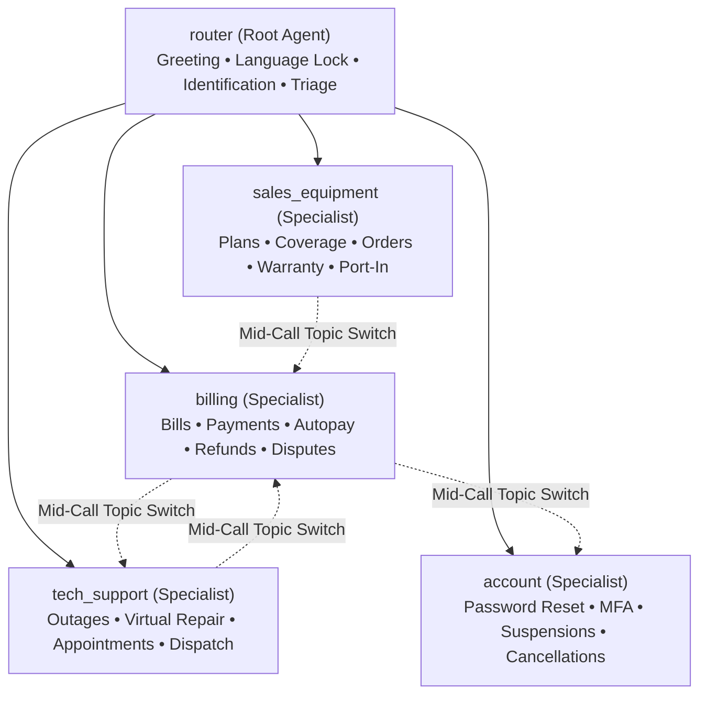

# Technical Design Document: Telco Voice Central (`snehsm-FDEBootcamp-CHI-greenfield`)

This document specifies the technical design, runtime topology, prompt architecture, callback contracts, and tool specifications for the `snehsm-FDEBootcamp-CHI-greenfield` Customer Experience Agent Studio (CXAS) voice application.

---

## 1. System Overview & Runtime Configuration

The `snehsm-FDEBootcamp-CHI-greenfield` agent provides automated, conversational voice resolution for enterprise telecommunications customers.

```
Telephony Inbound (SIP/RTP)
         │
         ▼
CXAS Voice Runtime (gemini-composite-v2 @ temp 1.0)
         │
         ├── before_model_callback (language_prompt_filter: Strategy B)
         │         │
         │         ▼
         ├── Agent Execution (router -> specialist tree)
         │         │
         │         ▼
         ├── Atomic Tool Execution (22 union-typed endpoints in lib/services.py)
         │         │
         │         ▼
         ├── after_model_callback (speech_hygiene: Markdown strip, PII mask, handoff guard)
         │
         ▼
Chirp3-HD TTS Engine (en-US, fr-CA, es-US) ──▶ Caller Audio
         │
         ▼
Cloud DLP & Telemetry (snehsm-FDEBootcamp-CHI-greenfield-pii-inspect / deidentify)
```

### Runtime Specifications
- **Agent Name**: `snehsm-FDEBootcamp-CHI-greenfield`
- **Application Directory**: `/usr/local/google/home/snehsm/.gemini/jetski/scratch/snehsm-FDEBootcamp-CHI-greenfield`
- **GCP Project**: `fde-bootcamp` (`LOCATION := us`)
- **App IDs**:
  - Canonical App: `d5500685-9bb1-402d-888d-ffe5409126ad` (`projects/fde-bootcamp/locations/us/apps/d5500685-9bb1-402d-888d-ffe5409126ad`)
  - Verified Main Candidate: `36cb81a0-ab18-4887-99c7-164221aab069` (`projects/fde-bootcamp/locations/us/apps/36cb81a0-ab18-4887-99c7-164221aab069`)
- **Foundation LLM**: `gemini-composite-v2` (`temperature: 1.0` per Google voice recommendations)
- **Audio Output Engine**: Google Cloud Text-to-Speech (Chirp3-HD):
  - English: `en-US-Chirp3-HD-Charon` (`speakingRate: 1.0`)
  - Canadian French: `fr-CA-Chirp3-HD-Charon` (`speakingRate: 1.0`)
  - Spanish: `es-US-Chirp3-HD-Charon` (`speakingRate: 1.0`)
- **Barge-In Configuration**: `bargeInAwareness: true`
- **Noise Suppression**: `HIGH`
- **Time Zone**: `America/New_York`
- **Privacy & Redaction**: Google Cloud Data Loss Prevention (Cloud DLP):
  - Inspection Template: `projects/fde-bootcamp/locations/us/inspectTemplates/snehsm-FDEBootcamp-CHI-greenfield-pii-inspect`
  - De-identification Template: `projects/fde-bootcamp/locations/us/deidentifyTemplates/snehsm-FDEBootcamp-CHI-greenfield-pii-deidentify`
- **Active Guardrails**:
  - `Default Safety Guardrail` (`enabled: true`): safety and harassment mitigation with localized fallback.
  - `Telco Deterministic Content Guardrail` (`enabled: true`, ADR-34): 0-ms deterministic pre-model regex filter enforcing telco content boundaries.
  - `Default Prompt Guardrail` (`enabled: false`, ADR-28): disabled after live voice telemetry showed +427 ms median per-turn latency and false positives on spoken French PINs, replaced by `Telco Deterministic Content Guardrail` plus tool-level policy gates.

---

## 2. 5-Agent Specialist Tree Topology

To avoid prompt crowding and prevent cross-domain confusion, the application employs a 5-agent hierarchy. All child agents are declared explicitly using exact directory names matching `cxas_app/agents/*`:



### Agent Roles & Directory Layout

#### 1. `cxas_app/agents/router` (Front Door / Entry Agent)
- **Role**: Greets caller with mandatory recording notice (`BR-TV-001`), locks caller language (`BR-TV-004`), identifies account by phone number or 9-digit account number (`lookup_account`), and routes caller to the appropriate specialist.
- **Immediate Deflection Capabilities**:
  - Emergency safety signals -> Disconnect / escalate.
  - Fraud claims -> Verbatim `empathy_protocol` + immediate `handover_to_person(reason="fraud_escalation")` (Level 2).
  - Business accounts (`business_flag == True`) -> Verbatim `business_handoff` + immediate `handover_to_person(reason="business_handoff")` (Level 5).
  - Explicit human requests -> Verbatim `live_agent_handoff` + immediate `handover_to_person(reason="user_requested_agent")` (Level 4).
- **Tools (3)**: `lookup_account`, `handover_to_person`, `end_session`
- **Child Agents (4)**: `billing`, `tech_support`, `sales_equipment`, `account`
- **Hard Rule**: Does **not** perform authentication or transactional tasks. Delegates authentication to the specialist agent.

#### 2. `cxas_app/agents/billing` (Billing & Payment Specialist)
- **Role**: Manages balances, payment processing with atomic service restoration, payment arrangements, autopay enrollment, and billing disputes / refunds.
- **Tools (11)**: `lookup_account`, `send_login_code`, `verify_login`, `get_billing_summary`, `process_bill_payment`, `setup_payment_arrangement`, `setup_autopay`, `process_refund_or_dispute`, `execute_suspend_restore`, `handover_to_person`, `end_session`
- **Enforcement Rules**:
  - Credit adjustments `<= $25.00`: Emits verbatim `refund_confirmation_pattern` with dynamic amounts and business days.
  - Credit adjustments `> $25.00`: Emits verbatim `transfer_to_specialist` and escalates via `handover_to_person(reason="refund_threshold_exceeded")` without ungrounded promises.
  - Duplicate payments (`VE-25`): Processes refund to source payment method without opening dispute case.
  - Autopay setup: Mandates verbatim `payment_method_preamble` (PCI compliance) prior to confirming payment method.

#### 3. `cxas_app/agents/tech_support` (Technical Support & Field Operations)
- **Role**: Outage mitigation, virtual repair troubleshooting across lines of business (Internet, Mobility, Satellite TV, Fibe TV app), and field technician appointment management.
- **Tools (10)**: `lookup_account`, `send_login_code`, `verify_login`, `check_regional_outage`, `run_troubleshooting_and_sms`, `get_appointment_and_ticket_status`, `manage_appointment`, `manage_warranty_claim`, `handover_to_person`, `end_session`
- **Enforcement Rules**:
  - Always requires caller postal code / ZIP before querying `check_regional_outage`.
  - Active outage: Emits verbatim `outage_active`, offers SMS restoration notification, and closes session.
  - Troubleshooting chains > 2 steps: Dispatches SMS guide (`run_troubleshooting_and_sms`).
  - Field appointments: Bundles appointment details and 2–3 reschedule slots in single atomic query (`get_appointment_and_ticket_status`).
  - Cancellations: Requires 2-step confirmation; rejects cancellation if technician status is `en_route`.

#### 4. `cxas_app/agents/sales_equipment` (Sales, Plans, & Warranty)
- **Role**: Service coverage validation, plan catalog recommendations, hardware order commits, warranty claims, and number port-in onboarding.
- **Tools (9)**: `lookup_account`, `send_login_code`, `verify_login`, `browse_plans_and_coverage`, `commit_plan_or_order`, `initiate_number_transfer`, `manage_warranty_claim`, `handover_to_person`, `end_session`
- **Enforcement Rules**:
  - Shortlists 2–3 targeted plans matching customer budget; never recites full catalog.
  - Orders: Generates order confirmation number, delivery ETA, and dispatches SMS receipt.
  - Swollen battery / hardware hazard: Immediately deflects to safety warning and emergency hardware replacement queue.
  - Port-In: Accepts empty/placeholder inputs to return full onboarding checklist (`required_port_checklist`).

#### 5. `cxas_app/agents/account` (Account Security & Lifecycle)
- **Role**: Password recovery, MFA administration, profile updates, voluntary suspensions/restorations, and service cancellations / port-outs.
- **Tools (10)**: `lookup_account`, `send_login_code`, `verify_login`, `send_password_reset_sms`, `manage_mfa_settings`, `execute_suspend_restore`, `update_contact_profile`, `cancel_or_port_out_service`, `handover_to_person`, `end_session`
- **Enforcement Rules**:
  - Password reset: Gated strictly on *Identified* state (no PIN/OTP demanded); SMS link valid for 30 minutes; link never spoken.
  - MFA management: Step-up authentication required for modifications (PIN + backup-email step-up code for lost devices).
  - Service cancellation / port-out: Enforces mandatory verbatim `contract_cancellation_fee_disclosure` and 2-step caller confirmation before execution.

---

## 3. Strategy B Dynamic All-Language Prompting Framework

To prevent prompt bloat and eliminate cross-language interference, `snehsm-FDEBootcamp-CHI-greenfield` implements **Strategy B (Dynamic In-Memory Prompt Injection)**.

### Architectural Mechanism
- Static agent instructions contain zero multi-language translation tables, keeping prompt tokens small and focused.
- A `before_model_callback` (`language_prompt_filter`) executes before every turn.
- It detects the caller's language (`en-US`, `fr-CA`, `es-US`) from session state or Turn 1 utterances and dynamically injects the appropriate `<active_language_sheet>` into memory for that single turn.
- State variables `_call_lang` and `_lang_locked` ensure language persistence across agent hops.

---

## 4. Speech Hygiene Engine (`after_model_callback`)

Every agent has a dedicated `after_model_callback` (`speech_hygiene`) configured to process `llm_response.content.parts`.

### Core Transformations
1. **Markdown Stripping**:
   - Strips all asterisks (`**bold**`), headers (`#`), bullet points (`- `, `* `), and backticks (`` `code` ``) to prevent the TTS engine from pronouncing symbols or producing robotic cadence.
2. **URL Protection**:
   - Replaces web links and URLs with spoken natural language (e.g., *"via text link"* or *"par lien texte"*), preventing synthetic reading of `https://...`.
3. **Card Digit Context Isolation**:
   - When callers provide payment card digits, the sanitizer preserves the card's last-4 and does not overwrite it with the caller's phone number last-4.
4. **Deterministic Handoff Verbatim Injection**:
   - If `handover_to_person` was invoked by the model during the turn and the model returned an empty string or omitted the mandated handoff string, the callback deterministically injects the localized verbatim `live_agent_handoff` copy into the output speech.

---

## 5. Atomic Sequential Tool Suite (22 Union-Typed Endpoints)

All tool definitions are implemented in `lib/services.py` and wrapped in `cxas_app/tools/*/python_function/python_code.py`.

### Mandatory Engineering Standards
- **Union Types (`Rule 32`)**: Every numeric or string parameter is typed as `str | int | float = ""` (e.g., `code: str | int = ""`), preventing unhandled casting exceptions when LLMs pass integers as strings or vice versa.
- **Fail-Safe Returns**: Tools never raise uncaught Python exceptions. Errors return structured dictionary payloads with `status="error"` and `error_message`.
- **Atomic State Mutation**: State updates (e.g. payment clearing balance + restoring service) execute atomically in a single tool call.

### Why Python Function Tools + Data Facade (`mock_mode`) over Raw API Connectors
Strongly union-typed JSON input/output schemas in `lib/services.py` normalize caller STT quirks (float `.0` stripping, digit grouping), enforce deterministic auth/policy caps (`$25` credit cap, 3-strike lockout) before any mutation, mask PII to `last4` + formatted dollar strings before the LLM sees results, and switch cleanly between deterministic mocks (`mock_mode="True"`) and live backend endpoints (`_call_live_backend` when `mock_mode="False"`) behind the identical tool contract.

### Complete Tool Inventory (22 Endpoints + `end_session`)

| # | Tool Name | Primary Agent | Key Parameters | Function & Responsibility |
|---|---|---|---|---|
| **1** | `lookup_account` | `router`, all | `phone: str \| int = ""`, `account_id: str \| int = ""` | Resolves CLID or BAN to internal customer profile. Sets `account_id` and initial identification. |
| **2** | `send_login_code` | Specialists | `phone: str = ""`, `channel: str = "sms"` | Dispatches 6-digit SMS OTP verification code. Sets `login_code_sent=True`. |
| **3** | `verify_login` | Specialists | `account_id: str = ""`, `code: str \| int = ""`, `pin: str \| int = ""` | Validates 4-digit PIN or 6-digit OTP. Elevates state to `Authenticated`. Tracks failure strikes. |
| **4** | `get_billing_summary` | `billing` | `account_id: str \| int = ""` | Returns account balance, due date, breakdown of charges, and recent payments. |
| **5** | `process_bill_payment` | `billing` | `account_id: str = ""`, `amount: float \| str = ""`, `card_last4: str = ""` | Commits one-time card payment. Clears suspension and restores active service atomically. |
| **6** | `setup_payment_arrangement` | `billing` | `account_id: str = ""`, `extended_days: int = 14`, `partial_amount: float = 0.0` | Establishes formal payment extension. Clears pending collection suspension. |
| **7** | `setup_autopay` | `billing` | `account_id: str = ""`, `method_type: str = "card"`, `card_last4: str = ""` | Enrolls account in recurring monthly autopay. Gated by mandatory PCI preamble. |
| **8** | `process_refund_or_dispute` | `billing` | `account_id: str = ""`, `amount: float = 0.0`, `reason: str = ""` | Evaluates fee adjustment. Auto-approves `<= $25.00`; escalates `> $25.00` to human queue. |
| **9** | `check_regional_outage` | `tech_support` | `postal_code: str = ""`, `service_type: str = "all"` | Queries network grid by Canadian postal code prefix. Returns active outage alerts and ETAs. |
| **10** | `run_troubleshooting_and_sms` | `tech_support` | `service_type: str = ""`, `phone: str = ""` | Runs virtual line diagnostics across 4 LOBs. Dispatches multi-step SMS repair guide. |
| **11** | `get_appointment_and_ticket_status` | `tech_support` | `account_id: str = ""`, `ticket_id: str = ""` | Bundles open repair tickets, tech dispatch status, and 2–3 reschedule slots in 1 query. |
| **12** | `manage_appointment` | `tech_support` | `appointment_id: str = ""`, `action: str = "reschedule"`, `slot: str = ""` | Commits reschedule or 2-step cancellation. Enforces en-route non-cancellation lock. |
| **13** | `browse_plans_and_coverage` | `sales_equipment` | `service_type: str = ""`, `postal_code: str = ""` | Checks address fiber/5G coverage. Shortlists 2–3 plans matching caller budget. |
| **14** | `commit_plan_or_order` | `sales_equipment` | `account_id: str = ""`, `plan_id: str = ""`, `order_type: str = ""` | Finalizes plan upgrade or hardware order. Returns order number, ETA, and SMS receipt. |
| **15** | `initiate_number_transfer` | `sales_equipment` | `target_phone: str = ""`, `current_carrier: str = ""` | Initiates port-in. Accepts placeholder inputs and outputs full required port-in checklist. |
| **16** | `manage_warranty_claim` | `sales_equipment` | `imei: str = ""`, `issue_description: str = ""` | Verifies device warranty. Deflects swollen battery hazard to emergency replacement. |
| **17** | `send_password_reset_sms` | `account` | `phone: str = ""`, `account_id: str = ""` | Dispatches 30-minute self-service password reset link. Link never spoken aloud. |
| **18** | `manage_mfa_settings` | `account` | `account_id: str = ""`, `action: str = "enable"`, `channel: str = "sms"` | Configures two-step verification. Requires PIN + step-up email OTP for lost devices. |
| **19** | `execute_suspend_restore` | `account`, `billing` | `account_id: str = ""`, `action: str = "restore"`, `reason: str = ""` | Directly toggles service suspension state for voluntary or non-payment holds. |
| **20** | `update_contact_profile` | `account` | `account_id: str = ""`, `email: str = ""`, `phone: str = ""` | Updates verified contact profile details on account record. |
| **21** | `cancel_or_port_out_service` | `account` | `account_id: str = ""`, `reason: str = ""` | Enforces contract cancellation fee disclosure and 2-step confirmation before termination. |
| **22** | `handover_to_person` | All Agents | `reason: str = ""`, `target_queue: str = "customer_service"`, `language: str = "en-US"` | Transfers session context and tracking ID to live human agent queues. |
| **—** | `end_session` | All Agents | `reason: str = ""` | Gracefully terminates session upon resolution, caller farewell, or handoff completion. |

---

## 6. Session State Variables (35 Declared Variables)

Declared in `cxas_app/app.json`:
- `account_id` (STRING, default `""`): Active account Ban/ID.
- `phone_last4` (STRING, default `""`): Account phone last 4 digits.
- `caller_provided_phone_last4` (STRING, default `""`): Digits caller uttered.
- `auth_status` (STRING, default `"none"`): `none`, `code_sent`, `pass`, `locked`.
- `login_code_sent` (BOOLEAN, default `false`): SMS OTP sent flag.
- `logged_in` (BOOLEAN, default `false`): Successful authentication flag.
- `auth_failure_count` (INTEGER, default `0`): Failed auth attempt counter.
- `login_attempts` (INTEGER, default `0`): Code login counter.
- `pin_failure_count` (INTEGER, default `0`): Invalid PIN attempts counter.
- `ban_last4` (STRING, default `""`): Account number last 4 digits.
- `customer_name` (STRING, default `""`): Name on file.
- `contact_phone` (STRING, default `""`): Primary phone.
- `contact_email` (STRING, default `""`): Contact email address.
- `current_balance` (STRING, default `""`): Total amount due.
- `balance_due_date` (STRING, default `""`): Payment due date.
- `line_of_business` (STRING, default `""`): Active product line.
- `outage_active` (BOOLEAN, default `false`): Postal code outage status.
- `outage_eta` (STRING, default `""`): Restoration ETA.
- `postal_code` (STRING, default `""`): Inquired postal code.
- `region` (STRING, default `""`): Geographic region.
- `regional_alert` (STRING, default `""`): Weather or alert text.
- `appointment_id` (STRING, default `""`): Active field dispatch ID.
- `appointment_date` (STRING, default `""`): Field appointment date.
- `appointment_window` (STRING, default `""`): Arrival time window.
- `technician_status` (STRING, default `""`): Status of field tech.
- `order_id` (STRING, default `""`): Committed order ID.
- `selected_plan_id` (STRING, default `""`): Target plan ID.
- `warranty_claim_id` (STRING, default `""`): Warranty claim tracking ID.
- `warranty_damage_checked` (BOOLEAN, default `false`): Physical damage check completed.
- `port_in_request_id` (STRING, default `""`): Port-in tracking ID.
- `preamble_spoken` (BOOLEAN, default `false`): PCI preamble compliance flag.
- `mfa_enabled` (BOOLEAN, default `false`): Account MFA status.
- `service_restored` (BOOLEAN, default `false`): Restoral action completed.
- `service_cancelled` (BOOLEAN, default `false`): Cancellation committed flag.
- `turn_index` (INTEGER, default `0`): Call turn counter.

---

## 7. Verification Gates & Deployment Ladder

```
[Local Fast Gate] -> Pytest unit tests, offline cxas lint (Exit Code 0)
        ↓
[Gate 1: Pull, Lint, & Push] -> cxas pull + cxas lint --app-dir cxas_app
        ↓
[Gate 2: Agent Hierarchy] -> Root agent router + 4 specialists validated
        ↓
[Gate 3: Tool Associations] -> 22 platform tools + end_session on all agents
        ↓
[Gate 4: Callback Inventory] -> 10 active callbacks + test discovery
        ↓
[Gate 5: Single-Turn Smoke] -> Live 'Hello' interaction with mandatory recording notice
        ↓
[Gate 6: Multi-Turn Smoke] -> 4-turn multi-topic session (Billing -> Tech Outage -> Farewell)
        ↓
[Gate 7: Full Benchmark] -> 70 public business scenarios (VE-01..VE-70):
                           63/70 strict 3/3 (90.0%), 69/70 majority (98.57%), 201/210 runs (95.71%)
```

### Evaluation Metrics Thresholds (`app.json`) & Certification Evidence
- **Evaluation Metrics Thresholds (`app.json`)**:
  - `goldenHallucinationMetricBehavior`: `"ENABLED"`
  - `goldenEvaluationMetricsThresholds.turnLevelMetricsThresholds.semanticSimilaritySuccessThreshold`: `3`
  - `goldenEvaluationMetricsThresholds.turnLevelMetricsThresholds.overallToolInvocationCorrectnessThreshold`: `1.0`
  - `goldenEvaluationMetricsThresholds.toolMatchingSettings.extraToolCallBehavior`: `"ALLOW"`
- **Strict Cloud Simulation Gate**: Strict `3/3` (`>= 90%`) cloud simulation gate (`63/70` = `90.0%` strict pass rate, `0` tool errors across 210 runs).
- **CXAS Agent Academy Live Voice Validation**: `93/100` clean unretried Run 11 (`a9addd3967604f47be4b93c44e2c754b`) on `git-135ff87` with `29/30` hidden scenarios; `99/100` official best with retries.
