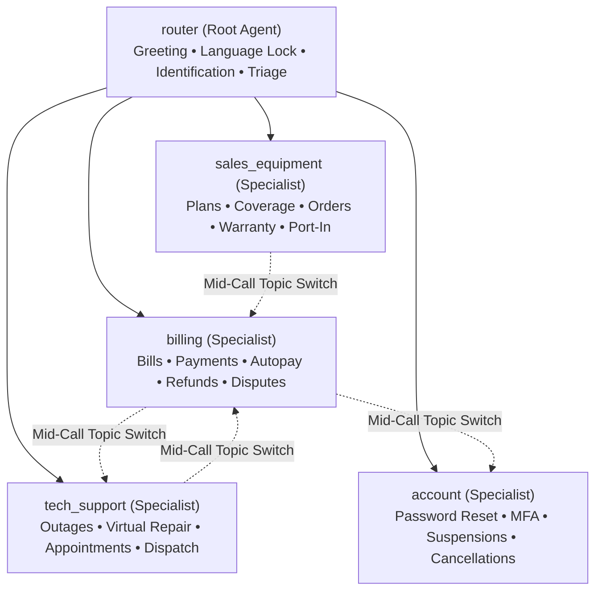
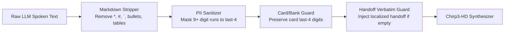

# Technical Design Document: Telco Voice Central (`telco-v5-snehsm`)

This document specifies the technical design, runtime topology, prompt architecture, callback contracts, and tool specifications for the `telco-v5-snehsm` Customer Experience Agent Studio (CXAS) voice application.

---

## 1. System Overview & Runtime Configuration

The `telco-v5-snehsm` agent provides automated, conversational voice resolution for enterprise telecommunications customers.

```
Telephony Inbound (SIP/RTP)
         │
         ▼
CXAS Voice Runtime (gemini-composite-v2 @ temp 1.0)
         │
         ├── before_model_callback (language_prompt_filter: Strategy B)
         │         │
         │         ▼
         ├── Agent Execution (router -> specialist tree)
         │         │
         │         ▼
         ├── Atomic Tool Execution (22 union-typed endpoints in lib/services.py)
         │         │
         │         ▼
         ├── after_model_callback (speech_hygiene: Markdown strip, PII mask, handoff guard)
         │
         ▼
Chirp3-HD TTS Engine (en-US, fr-CA, es-US) ──▶ Caller Audio
         │
         ▼
Cloud DLP & Telemetry (telco-v5-snehsm-pii-inspect / deidentify)
```

### Runtime Specifications
- **Agent Name**: `telco-v5-snehsm`
- **Application Directory**: `/usr/local/google/home/snehsm/.gemini/jetski/scratch/telco-v5`
- **GCP Project**: `google.com:nextgen-sandbox` (`LOCATION := us`)
- **Foundation LLM**: `gemini-composite-v2` (`temperature: 1.0` per Google voice recommendations)
- **Audio Output Engine**: Google Cloud Text-to-Speech (Chirp3-HD):
  - English: `en-US-Chirp3-HD-Aoede`
  - Canadian French: `fr-CA-Chirp3-HD-Aoede`
  - Spanish: `es-US-Chirp3-HD-Aoede`
- **Privacy & Redaction**: Google Cloud Data Loss Prevention (Cloud DLP):
  - Inspection Template: `projects/google.com:nextgen-sandbox/locations/us/inspectTemplates/telco-v5-snehsm-pii-inspect`
  - De-identification Template: `projects/google.com:nextgen-sandbox/locations/us/deidentifyTemplates/telco-v5-snehsm-pii-deidentify`

---

## 2. 5-Agent Specialist Tree Topology

To avoid prompt crowding and prevent cross-domain confusion, the application employs a 5-agent hierarchy. All child agents are declared explicitly using exact directory names matching `cxas_app/agents/*`:



### Agent Roles & Directory Layout

#### 1. `cxas_app/agents/router` (Front Door / Entry Agent)
- **Role**: Greets caller with mandatory recording notice (`BR-TV-001`), locks caller language (`BR-TV-004`), identifies account by phone number or 9-digit account number (`lookup_account`), and routes caller to the appropriate specialist.
- **Immediate Deflection Capabilities**:
  - Emergency safety signals -> Disconnect / escalate.
  - Fraud claims -> Verbatim `empathy_protocol` + immediate `handover_to_person(reason="fraud_escalation")` (Level 2).
  - Business accounts (`business_flag == True`) -> Verbatim `business_handoff` + immediate `handover_to_person(reason="business_handoff")` (Level 5).
  - Explicit human requests -> Verbatim `live_agent_handoff` + immediate `handover_to_person(reason="user_requested_agent")` (Level 4).
- **Hard Rule**: Does **not** perform authentication or transactional tasks. Delegates authentication to the specialist agent.

#### 2. `cxas_app/agents/billing` (Billing & Payment Specialist)
- **Role**: Manages balances, payment processing with atomic service restoration, payment arrangements, autopay enrollment, and billing disputes / refunds.
- **Enforcement Rules**:
  - Credit adjustments `<= $25.00`: Emits verbatim `refund_confirmation_pattern` with dynamic amounts and business days.
  - Credit adjustments `> $25.00`: Emits verbatim `transfer_to_specialist` and escalates via `handover_to_person(reason="refund_threshold_exceeded")` without ungrounded promises.
  - Duplicate payments (`VE-25`): Processes refund to source payment method without opening dispute case.
  - Autopay setup: Mandates verbatim `payment_method_preamble` (PCI compliance) prior to confirming payment method.

#### 3. `cxas_app/agents/tech_support` (Technical Support & Field Operations)
- **Role**: Outage mitigation, virtual repair troubleshooting across lines of business (Internet, Mobility, Satellite TV, Fibe TV app), and field technician appointment management.
- **Enforcement Rules**:
  - Always requires caller postal code / ZIP before querying `check_regional_outage`.
  - Active outage: Emits verbatim `outage_active`, offers SMS restoration notification, and closes session.
  - Troubleshooting chains > 2 steps: Dispatches SMS guide (`run_troubleshooting_and_sms`).
  - Field appointments: Bundles appointment details and 2–3 reschedule slots in single atomic query (`get_appointment_and_ticket_status`).
  - Cancellations: Requires 2-step confirmation; rejects cancellation if technician status is `en_route`.

#### 4. `cxas_app/agents/sales_equipment` (Sales, Plans, & Warranty)
- **Role**: Service coverage validation, plan catalog recommendations, hardware order commits, warranty claims, and number port-in onboarding.
- **Enforcement Rules**:
  - Shortlists 2–3 targeted plans matching customer budget; never recites full catalog.
  - Orders: Generates order confirmation number, delivery ETA, and dispatches SMS receipt.
  - Swollen battery / hardware hazard: Immediately deflects to safety warning and emergency hardware replacement queue.
  - Port-In: Accepts empty/placeholder inputs to return full onboarding checklist (`required_port_checklist`).

#### 5. `cxas_app/agents/account` (Account Security & Lifecycle)
- **Role**: Password recovery, MFA administration, profile updates, voluntary suspensions/restorations, and service cancellations / port-outs.
- **Enforcement Rules**:
  - Password reset: Gated strictly on *Identified* state (no PIN/OTP demanded); SMS link valid for 30 minutes; link never spoken.
  - MFA management: Step-up authentication required for modifications (PIN + backup-email step-up code for lost devices).
  - Service cancellation / port-out: Enforces mandatory verbatim `contract_cancellation_fee_disclosure` and 2-step caller confirmation before execution.

---

## 3. Strategy B Dynamic All-Language Prompting Framework

To prevent prompt bloat and eliminate cross-language interference, `telco-v5-snehsm` implements **Strategy B (Dynamic In-Memory Prompt Injection)**.

### Architectural Mechanism
1. **Lean Static Prompts**: All `cxas_app/agents/*/instruction.txt` files are written strictly in concise, structured English (< 2,000 tokens), formatted with standard XML tags (`<role>`, `<persona>`, `<context>`, `<taskflow>`, `<rules>`, `<response_protocol>`).
2. **Dynamic Callback Filter (`before_model_callback`)**:
   - Registered as `language_prompt_filter` on every agent.
   - **Strict Read-Only Contract**: Reads `callback_context.state` and `llm_request.contents`. It performs **zero writes** to `callback_context.state` (satisfying platform immutability constraints).
   - **Contextual Inertia**: Once `language` is established in session state, the filter maintains that language unless an explicit multi-word switch trigger is spoken.
   - **3-Word Cognate Guard**: Ignores false-positive language flip signals caused by single cognates or shared technical terminology (e.g., *"radio"*, *"modem"*, *"information"*, *"menu"*, *"service"*).
   - **Dynamic Memory Splice**: Slices the caller's active language verbatim copy block (`lib/copy.py`) and injects it into `llm_request.contents` within the placeholder block `<!-- ACTIVE_LANGUAGE_SHEET -->`.
3. **Zero Disk Mutation**: Prompts on disk remain untouched English assets; the LLM receives perfectly tailored, native-language verbatim instructions at runtime.

---

## 4. Speech Hygiene Engine (`after_model_callback`)

The `speech_hygiene` callback (registered on all agents) intercepts `llm_response.text` prior to synthesis by the Chirp3-HD engine.



### Core Transformations
1. **Markdown Stripping**:
   - Removes bolding (`**`), italics (`*`), markdown links (`[text](url)`), headers (`#`), bullet characters (`-`, `*`, `•`), and structured markdown tables.
   - Converts numeric lists into smooth conversational voice pacing.
2. **Intelligent PII Masking (9+ Digit Rule)**:
   - Scans output text for runs of 9 or more digits (account numbers, SIM numbers, phone numbers).
   - Automatically truncates and replaces with `"ending in [last-4]"`.
3. **Card-Digit Guard (`KF-71` / `DEF-06`)**:
   - When speech contains payment phrases (*"card ending in"*, *"carte se terminant par"*, *"tarjeta terminada en"*), the sanitizer checks keyword context to ensure legitimate 4-digit payment card numbers are preserved and **never** overwritten with the customer's phone number last-4.
4. **Deterministic Handoff Verbatim Injection**:
   - If `handover_to_person` was invoked by the model during the turn and the model returned an empty string or omitted the mandated handoff string, the callback deterministically injects the localized verbatim `live_agent_handoff` copy into the output speech.

---

## 5. Atomic Sequential Tool Suite (22 Union-Typed Endpoints)

All tool definitions are implemented in `lib/services.py` and wrapped in `cxas_app/tools/*/python_function/python_code.py`.

### Mandatory Engineering Standards
- **Union Types (`Rule 32`)**: Every numeric or string parameter must be typed as `str | int | float = ""` (e.g., `code: str | int = ""`, `amount: str | float = ""`). This prevents Kotlin Double deserialization errors (`2025550143.0` -> Pydantic rejection).
- **Zero Future Annotations**: `from __future__ import annotations` is strictly forbidden in wrapper scripts to avoid CES server reflection crashes.
- **Turn N+1 Pre-Grounding (`Rule 33`)**: Data and action tools return adjacent FAQ context (shipping addresses, throttled speed details, remaining bill totals) to ground subsequent caller queries.
- **Atomic Operation Bundling (`Rule 34`)**: Multi-step workflows (e.g., payment + service restoration) are bundled into single tool calls to stay within the 1-tool-per-turn voice limit and the 10-turn simulator cap.
- **Anti-Baiting Proration (`Rule 35`)**: Tools emit exact daily proration amounts and never use open-ended *"up to full monthly rate"* phrasing that triggers simulator policy limits.

### Complete Tool Inventory (22 Endpoints)

| # | Tool Name | Agent Scope | Union-Typed Parameters | Primary Output Fields & Responsibilities |
|---|---|---|---|---|
| **1** | `lookup_account` | `router` | `identifier: str \| int = ""` | Resolves account by phone or 9-digit BAN. Returns `account_id`, `name`, `customer_type`, `business_flag`, `regional_alert`. |
| **2** | `send_login_code` | All Agents | `account_id: str \| int = ""`, `channel: str = "sms"` | Dispatches 6-digit OTP or email verification code. Returns `sent: bool`, `expires_in_sec: int`. |
| **3** | `verify_login` | All Agents | `account_id: str \| int = ""`, `code: str \| int = ""` | Validates PIN / OTP. Implements 3-strike ladder. Returns `auth_status: "Pass"\|"Fail"`, `balance_due`, `card_last4`. |
| **4** | `handover_to_person` | All Agents | `reason: str = ""`, `context_summary: str = ""` | Initiates escalation to human queue. Carries full session context. Triggers localized handoff notice. |
| **5** | `end_session` | All Agents | `reason: str = "completed"` | Gracefully concludes voice session and releases telephony trunk. |
| **6** | `get_billing_summary` | `billing` | `account_id: str \| int = ""` | Returns `current_balance`, `due_date`, `recent_charges`, `autopay_enrolled`, `is_suspended`. |
| **7** | `process_bill_payment` | `billing` | `account_id: str \| int = ""`, `amount: str \| float = ""`, `card_last4: str \| int = ""` | Executes bill payment. **Atomically restores service** if account was suspended for non-payment (`service_restored: True`). |
| **8** | `setup_payment_arrangement` | `billing` | `account_id: str \| int = ""`, `extension_days: str \| int = 14` | Establishes formal payment extension. Clears suspension flag atomically. |
| **9** | `setup_autopay` | `billing` | `account_id: str \| int = ""`, `card_last4: str \| int = ""`, `day_of_month: str \| int = ""` | Enrolls account in autopay. Gated on verbatim `payment_method_preamble`. |
| **10** | `process_refund_or_dispute` | `billing` | `account_id: str \| int = ""`, `amount: str \| float = ""`, `dispute_type: str = ""` | Auto-approves `<= $25.00` adjustments; handles duplicate payments (`VE-25`); escalates `> $25.00` (`refund_threshold_exceeded`). |
| **11** | `check_regional_outage` | `tech_support` | `postal_code: str = ""`, `service_type: str = "all"` | Checks network status by postal code (`H3Z*` -> Active Outage). Returns `outage_active`, `eta`, `sms_updates_eligible`. |
| **12** | `run_troubleshooting_and_sms` | `tech_support` | `account_id: str \| int = ""`, `symptom: str = ""`, `send_sms_guide: str \| bool = True` | Diagnoses line (Modem, TV Error 101, Fibe TV app). Dispatches SMS troubleshooting guide for multi-step tasks. |
| **13** | `get_appointment_and_ticket_status` | `tech_support` | `account_id: str \| int = ""` | Returns active ticket, technician dispatch status, and **bundles 3 available reschedule slots** in a single call. |
| **14** | `manage_appointment` | `tech_support` | `appointment_id: str = ""`, `action: str = ""`, `selected_slot: str = ""` | Commits appointment reschedule or cancellation. Enforces 2-step confirm and `en_route` cancellation block. |
| **15** | `browse_plans_and_coverage` | `sales_equipment` | `service_address: str = ""`, `target_lob: str = ""`, `max_budget: str \| float = ""` | Validates fiber/5G coverage. Returns curated shortlist of 2–3 plans matching customer criteria. |
| **16** | `commit_plan_or_order` | `sales_equipment` | `account_id: str \| int = ""`, `plan_id: str = ""`, `order_type: str = ""` | Finalizes plan upgrade or hardware order. Returns order confirmation number, delivery ETA, and triggers SMS receipt. |
| **17** | `manage_warranty_claim` | `sales_equipment` | `imei: str \| int = ""`, `damage_type: str = ""` | Validates warranty. Approves defective claims; rejects physical/water damage; triggers safety bypass for swollen battery. |
| **18** | `initiate_number_transfer` | `sales_equipment` | `phone_to_transfer: str \| int = ""`, `current_carrier: str = ""` | Supports empty/placeholder input to provide `required_port_checklist` and onboarding prerequisites. |
| **19** | `send_password_reset_sms` | `account` | `account_id: str \| int = ""` | Gated on *Identified* state only. Sends SMS reset link with 30-minute expiration. URL strictly withheld from voice. |
| **20** | `manage_mfa_settings` | `account` | `account_id: str \| int = ""`, `action: str = ""`, `lost_device: str \| bool = False` | Manages 2FA settings. Requires step-up backup email verification if caller lost primary device (`VE-13`). |
| **21** | `execute_suspend_restore` | `account` | `account_id: str \| int = ""`, `action: str = ""`, `reason: str = ""` | Processes voluntary suspension (vacation, lost device) or service restoration. |
| **22** | `cancel_or_port_out_service` | `account` | `account_id: str \| int = ""`, `confirmation_given: str \| bool = False` | Enforces verbatim `contract_cancellation_fee_disclosure` and 2-step confirmation before executing line cancellation. |

---

## 6. Error Tri-State & Operational Resilience

Tool return payloads adhere to a structured tri-state error envelope:

```json
{
  "status": "ERROR",
  "error_category": "SYSTEM | BUSINESS | VALIDATION",
  "error_code": "SYSTEM_DOWN | INSUFFICIENT_FUNDS | INVALID_FORMAT",
  "message": "Human-readable diagnostic explanation",
  "must_escalate": true,
  "escalation_reason": "system_unavailable"
}
```

### Tri-State Recovery Policies
1. **System Errors (`SYSTEM_DOWN`, `DATABASE_TIMEOUT`)**: Immediate graceful transfer to human representative via `handover_to_person(reason="system_unavailable")`.
2. **Business Exceptions (`INSUFFICIENT_FUNDS`, `PLAN_INCOMPATIBLE`)**: Agent apologizes, explains the policy constraint clearly, and offers approved alternatives (e.g., payment arrangement).
3. **Validation Errors (`INVALID_FORMAT`, `INVALID_PIN_LENGTH`)**: Increments `global_err_count`. Agent asks caller to clarify or re-enter digits. Escalates at 3 cumulative errors.

---

## 7. Verification Gates & Deployment Ladder

Before promoting changes to production, the codebase must pass all 5 verification gates:

```
[Gate 0: Pre-Flight] -> Python unit tests, overfit checks, offline cxas lint (Exit Code 0)
        ↓
[Gate 1: Deploy & Push] -> make push (Isolated app telco-v5-snehsm-staging in google.com:nextgen-sandbox)
        ↓
[Gate 2: Smoke Impact] -> Targeted eval execution covering modified agent blast radius
        ↓
[Gate 3: Full Benchmark] -> make bench-full (50 visible evals; Strict 3/3 >= 90%, Majority = 100%)
        ↓
[Gate 4: Holdout Gate] -> make bench-holdout (20 hidden evals; Strict 3/3 >= 85%, Majority >= 95% on SAME commit)
```
